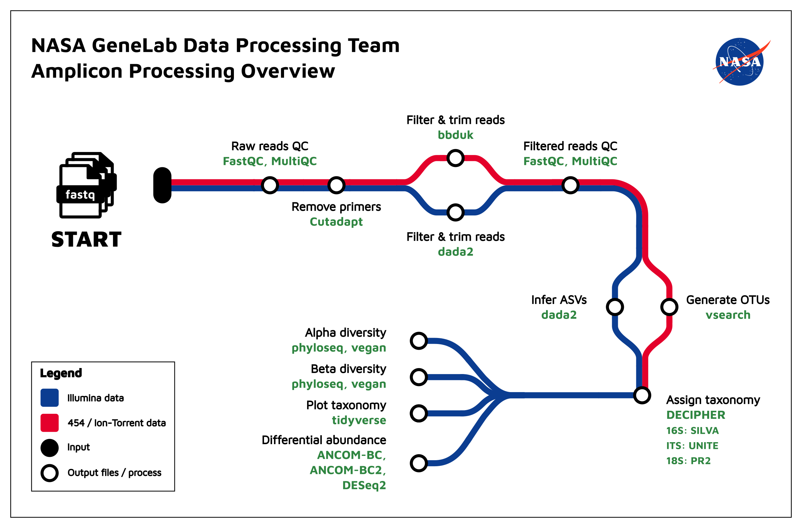

# GeneLab Amplicon Illumina Sequencing Data Processing Workflow

> GeneLab, part of NASA's [Open Science Data Repository (OSDR)](https://www.nasa.gov/osdr/), has wrapped each step of the Illumina amplicon sequencing data processing pipeline ([AmpIllumina](https://github.com/nasa/GeneLab_Data_Processing/tree/master/Amplicon)), starting with pipeline version C, into a Nextflow workflow. This repository contains the Nextflow workflow code (NF_AmpIllumina) along with instructions for installation and usage. Exact workflow and protocol versions used for released datasets are recorded with their processed data in OSDR under 'Files' → 'GeneLab Processed Diversity Amplicon Files' → 'Processing Info'.

## General Workflow Information

### Implementation Tools

The current GeneLab Illumina amplicon sequencing data processing pipeline (AmpIllumina) ([GL-DPPD-7104-C](https://github.com/nasa/GeneLab_Data_Processing/blob/master/Amplicon/Illumina/Pipeline_GL-DPPD-7104_Versions/GL-DPPD-7104-C.md)) is implemented as a single [Nextflow](https://nextflow.io/) DSL2 workflow that utilizes [Singularity](https://docs.sylabs.io/guides/3.10/user-guide/introduction.html) to run all tools in containers. This workflow (NF_AmpIllumina) is run using the command line interface (CLI) of any unix-based system. While knowledge of creating workflows in Nextflow is not required to run the workflow as is, [the Nextflow documentation](https://nextflow.io/docs/latest/index.html) is a useful resource for users who want to modify and/or extend this workflow.

### Resource Requirements <!-- omit in toc -->

The table below details the default maximum resource allocations for individual Nextflow processes.

| CPU Cores | Memory |
|-------------------|----------------|
| 10                | 20 GB          |

> **Note:** These per-process resource allocations are defaults. They can be adjusted by modifying `cpus` and `memory` directives in the configuration file: [conf/process_resources.config](workflow_code/conf/process_resources.config).

<br>

<details open>
<summary>NF_AmpIllumina workflow</summary>
<p align="center">
<a href="images/GL-amplicon-subwayplot.png"></a>
</p>
</details>

## Utilizing the Workflow

1. [Install Nextflow and Singularity](#1-install-nextflow-and-singularity)  
   1a. [Install Nextflow](#1a-install-nextflow)  
   1b. [Install Singularity](#1b-install-singularity)  
2. [Download the Workflow Files](#2-download-the-workflow-files)  
3. [Fetch Singularity Images](#3-fetch-singularity-images)  
4. [Run the Workflow](#4-run-the-workflow)  
   4a. [Approach 1: Start with OSD or GLDS accession as input](#4a-approach-1-start-with-osd-or-glds-accession-as-input)  
   4b. [Approach 2: Run the workflow using an ISA Archive](#4b-approach-2-run-the-workflow-using-an-isa-archive)  
   4c. [Approach 3: Start with a runsheet csv file as input](#4c-approach-3-start-with-a-runsheet-csv-file-as-input)  
   4d. [Modify parameters and compute resources in the Nextflow config file](#4d-modify-parameters-and-compute-resources-in-the-nextflow-config-file)  
5. [Workflow Outputs](#5-workflow-outputs)  
   5a. [Main outputs](#5a-main-outputs)  
   5b. [Resource logs](#5b-resource-logs)  
6. [Post-processing](#6-post-processing)

<br>

---

### 1. Install Nextflow and Singularity

#### 1a. Install Nextflow

Nextflow can be installed either through [Anaconda](https://anaconda.org/bioconda/nextflow) or as documented on the [Nextflow documentation page](https://www.nextflow.io/docs/latest/getstarted.html).

> [!NOTE]
> If you want to install Anaconda, we recommend installing a Miniforge version appropriate for your system, as documented on the [conda-forge website](https://conda-forge.org/download/), where you can find basic binaries for most systems. More detailed miniforge documentation is available in the [miniforge github repository](https://github.com/conda-forge/miniforge).
>
> Once conda is installed on your system, you can install the latest version of Nextflow by running the following commands:
>
> ```bash
> conda install -c bioconda nextflow
> nextflow self-update
> ```
> You may also install [mamba](https://mamba.readthedocs.io/en/latest/index.html) first which is a faster implementation of conda and can be used as a drop-in replacement:
> ```bash
> conda install -c conda-forge mamba
> ```

<br>

#### 1b. Install Singularity

Singularity is a container platform that allows usage of containerized software. This enables the GeneLab AmpIllumina workflow to retrieve and use all software required for processing without the need to install the software directly on the user's system.

We recommend installing Singularity on a system wide level as per the associated [documentation](https://docs.sylabs.io/guides/3.10/admin-guide/admin_quickstart.html).

> [!NOTE]
> Singularity is also available through [Anaconda](https://anaconda.org/conda-forge/singularity).
>
> Alternatively, Docker can be used in place of Singularity. See the [Docker CE installation documentation](https://docs.docker.com/engine/install/).

<br>

---

### 2. Download the Workflow Files

All files required for utilizing the NF_AmpIllumina GeneLab workflow for processing amplicon Illumina data are in the [workflow_code](workflow_code) directory. To get a copy of the latest NF_AmpIllumina version on to your system, the code can be downloaded as a zip file from the release page then unzipped after downloading by running the following commands:

```bash
wget https://github.com/nasa/GeneLab_AmpliconSeq_Workflow/releases/download/v1.0.10/NF_AmpIllumina_1.0.10.zip

unzip NF_AmpIllumina_1.0.10.zip
```

<br>

---

### 3. Fetch Singularity Images

Although Nextflow can fetch Singularity images from a url, doing so may cause issues as detailed [here](https://github.com/nextflow-io/nextflow/issues/1210).

To avoid this issue, run the following command to fetch the Singularity images prior to running the NF_AmpIllumina workflow:
> [!NOTE]
> This command should be run in the location containing the NF_AmpIllumina_1.0.10 directory that was downloaded in [step 2](#2-download-the-workflow-files) above. Depending on your network speed, fetching the images will take ~20 minutes. Approximately 4GB of RAM is needed to download and build the Singularity images.

```bash
bash NF_AmpIllumina_1.0.10/bin/prepull_singularity.sh NF_AmpIllumina_1.0.10/conf/by_docker_image.config
```

Once complete, a "singularity" folder containing the Singularity images will be created. Run the following command to export this folder as a Nextflow configuration environment variable to ensure Nextflow can locate the fetched images:

```bash
export NXF_SINGULARITY_CACHEDIR=$(pwd)/singularity
```

<br>

---

### 4. Run the Workflow

While in the location containing the NF_AmpIllumina_1.0.10 directory that was downloaded in [step 2](#2-download-the-workflow-files), you are now able to run the workflow.

Below are three examples of how to run the NF_AmpIllumina workflow:

> [!NOTE]
> Nextflow commands use both single hyphen arguments (e.g. `-profile`) that denote general Nextflow arguments and double hyphen arguments (e.g. `--target_region`) that denote workflow specific parameters. Take care to use the proper number of hyphens for each argument.
>
> To use Docker instead of Singularity, use `-profile docker`. Nextflow will automatically pull images as needed.
>
> The `-resume` option can be used to resume a previous workflow run by reusing compatible cached tasks (see [Nextflow documentation](https://www.nextflow.io/docs/latest/cache-and-resume.html)). If parameters change, Nextflow reruns tasks whose cache is invalidated and reuses cached results where possible.

<br>

#### 4a. Approach 1: Start with OSD or GLDS accession as input

```bash
nextflow run NF_AmpIllumina_1.0.10/main.nf \
   -profile singularity,local \
   --accession OSD-487 \
   --target_region 16S
```

#### 4b. Approach 2: Run the workflow using an ISA Archive

```bash
nextflow run NF_AmpIllumina_1.0.10/main.nf \
   -profile singularity,local \
   --accession OSD-487 \
   --isa_archive /path/to/study-ISA.zip \
   --target_region 16S
```

> [!NOTE]
> Specifications for the ISA Tab Archive format can be found [here](https://isa-specs.readthedocs.io/en/latest/isatab.html).

#### 4c. Approach 3: Start with a runsheet csv file as input

```bash
nextflow run NF_AmpIllumina_1.0.10/main.nf \
   -profile singularity,local \
   --runsheet PE_file.csv \
   --target_region 16S \
   --F_primer AGAGTTTGATCCTGGCTCAG \
   --R_primer CTGCCTCCCGTAGGAGT
```

> [!NOTE]
> Specifications for creating a runsheet manually are described in the [runsheet README](examples/runsheet/README.md).

#### Required Parameters For All Approaches:

* `NF_AmpIllumina_1.0.10/main.nf` - Instructs Nextflow to run the NF_AmpIllumina workflow

* `-profile` - Specifies the configuration profile(s) to load (multiple options can be provided as a comma-separated list)

  * Software environment profile options (choose one):
    * `singularity` - instructs Nextflow to use Singularity container environments
    * `docker` - instructs Nextflow to use Docker container environments
    * `conda` - instructs Nextflow to use conda environments via the conda package manager
    * `mamba` - instructs Nextflow to use conda environments via the mamba package manager

  * Other options (can be combined with the software environment option above using a comma, e.g. `-profile singularity,local`):
    * `local` - instructs Nextflow to run jobs on the local computer ([local.config](workflow_code/conf/local.config))
    * `slurm` - instructs Nextflow to use the [Slurm cluster management and job scheduling system](https://slurm.schedmd.com/overview.html) to schedule and run the jobs on a Slurm HPC cluster ([slurm.config](workflow_code/conf/slurm.config))

> [!NOTE]
> By default, the `conda` and `mamba` profiles create environments at runtime using the YAML files in the [workflow_code/envs](workflow_code/envs/) folder. You can change this behavior by using the `--conda_*` workflow parameters or by editing the [nextflow.config](workflow_code/nextflow.config) file to specify a centralized conda environments directory via the `conda.cacheDir` parameter.

* `--target_region` - Amplicon target region: 16S, 18S or ITS (type: string, default: "16S")

<br>

**Additional Required Parameters For [Approach 1](#4a-approach-1-start-with-osd-or-glds-accession-as-input):**

* `--accession` - The OSD or GLDS accession number specifying the [OSDR](https://osdr.nasa.gov/bio/repo/) dataset to process, e.g. OSD-487 or GLDS-487 (type: string, default: null)

> [!NOTE]
> Not all datasets have the same OSD and GLDS number, so make sure the correct OSD or GLDS number is specified.

<br>

**Additional Required Parameters For [Approach 2](#4b-approach-2-run-the-workflow-using-an-isa-archive):**

* `--accession` - The OSD or GLDS accession number specifying the [OSDR](https://osdr.nasa.gov/bio/repo/) dataset to process, e.g. OSD-487 or GLDS-487 (type: string, default: null)

> [!NOTE]
> Not all datasets have the same OSD and GLDS number, so make sure the correct OSD or GLDS number is specified.

* `--isa_archive` - Path to a local ISA archive for approach 2; when unset, the archive is downloaded for the supplied accession (type: string, default: null)

<br>

**Additional Required Parameters For [Approach 3](#4c-approach-3-start-with-a-runsheet-csv-file-as-input):**

* `--runsheet` - Specifies the path to a local runsheet. `--input_file` is also accepted for workflow execution (type: string, default: null)

* `--F_primer` - Forward primer sequence; required for primer removal from raw reads (`--trim_primers true`) (type: string, default: null)

* `--R_primer` - Reverse primer sequence; required for primer removal from raw reads (`--trim_primers true`) (type: string, default: null)

<br>

#### Optional Parameters

* `--outdir` - Specifies the base directory where the output directories will be created (type: string, default: "${launchDir}")

* `--stage_only` - Publish the runsheet and staged inputs for the selected `--entry_point`, then exit. `--truncate_to` applies to raw and trimmed reads (type: boolean, default: false)

* `--post_processing` - Run the post-processing workflow (type: boolean, default: false)

* `--database_store_path` - Directory where DECIPHER reference databases will be downloaded and stored (type: string, default: "./Reference_DBs")

* **Primer Removal Parameters** - Options for removing primers with Cutadapt:

  * `--trim_primers` - Remove primers with Cutadapt when starting from raw reads (type: boolean, default: true)

  * `--primers_linked` - Treat forward and reverse primers as linked adapters expected on the same read (type: boolean, default: true)

  * `--anchored_primers` - Anchor primer matching at the start of reads (type: boolean, default: true)

  * `--min_cutadapt_len` - Minimum retained read length (in bases) after primer removal with Cutadapt. Reads shorter than this value are discarded (type: integer, default: 130)

  * `--discard_untrimmed` - Discard reads without detected primers (type: boolean, default: true)

* **DADA2 Filtering Parameters** - Options for filtering and truncating reads before ASV inference:

  * `--left_trunc` - Truncate forward reads to this length in bases during DADA2 filterAndTrim(). Bases beyond this position are removed; shorter reads are discarded. Set to 0 to disable length truncation (type: integer, default: 0)

  * `--right_trunc` - Truncate reverse reads to this length in bases during DADA2 filterAndTrim(). Bases beyond this position are removed; shorter reads are discarded. Set to 0 to disable length truncation (type: integer, default: 0)

  * `--left_maxEE` - Maximum expected errors allowed in forward reads (type: integer, default: 1)

  * `--right_maxEE` - Maximum expected errors allowed in reverse reads (type: integer, default: 1)

* **Diversity and Differential Abundance Parameters** - Options for diversity and differential abundance analyses:

  * `--rarefaction_depth` - Target minimum read count per sample for rarefaction in alpha diversity and Bray-Curtis beta diversity analyses. The workflow uses the lowest sample count at or above this value, or the lowest count if none reach it. Samples below the selected depth are excluded (type: integer, default: 500)

  * `--diff_abund_method` - Differential abundance testing method to run. all runs ANCOMBC v1, ANCOMBC v2 and DESeq2 (type: string, options: all, ancombc1, ancombc2, or deseq2, default: "all")

* **Output Naming Parameters** - Options for naming output files:

  * `--output_prefix` - Prefix to add to output filenames, e.g. "Study1_". An underscore is appended unless the prefix already ends with '_' or '-'. Leave empty for no prefix (type: string, default: "")

  * `--assay_suffix` - Assay label appended to output filenames. The target region is inserted before this suffix when `--prepend_target_region` is true (type: string, default: "_GLAmpSeq")

  * `--prepend_target_region` - Prepend `--target_region` to `--assay_suffix`, e.g. "_16S_GLAmpSeq" for a 16S run. By default the assay suffix is used as supplied (type: boolean, default: false)

* **Sample Selection Parameters** - Options for selecting samples and reads:

  * `--truncate_to` - Use the first N FASTQ records from each raw or trimmed input file (type: integer, default: null)

  * `--limit_samples_to` - Process only the first specified number of samples from the runsheet (type: integer, default: null)

  * `--force_single_end` - Process paired-end data as single-end data using the selected read (type: string, options: "R1" or "R2", default: null)

* **Entry Point Parameters** - Options for starting the workflow from different processing steps:

> [!NOTE]
> When using `--accession` and running the workflow from an intermediate entry point, the workflow downloads the input files from [OSDR](https://osdr.nasa.gov/bio/repo/) and generates the runsheet containing the required metadata. See the [runsheet README](examples/runsheet/README.md) for runsheet format details.

* `--entry_point` - Specifies the workflow entry point to start from (type: string, default: "raw_reads"). Available options:
  - `raw_reads` - Start from raw read files (.fastq.gz) (default)
  - `trimmed_reads` - Start from primer-trimmed read files (.fastq.gz). Raw read quality-checking and primer removal are skipped
  - `asv_tables` - Start from one ASV count table and one taxonomy table for the full dataset (e.g. counts_GLAmpSeq.tsv and taxonomy_GLAmpSeq.tsv)

**Additional Optional Parameters:**

For additional optional workflow parameters, run the following command:

```bash
nextflow run NF_AmpIllumina_1.0.10/main.nf --help
```

#### 4d. Modify parameters and compute resources in the Nextflow config file

Additionally, workflow parameters can be directly specified in the [nextflow.config](workflow_code/nextflow.config) file. For detailed instructions on how to modify and set parameters in the config file, please see the [documentation here](https://www.nextflow.io/docs/latest/config.html).

Once you've downloaded the workflow template, you can modify the parameters in the `params` scope in [nextflow.config](workflow_code/nextflow.config) and CPU/memory requirements in the `process` scope in [conf/process_resources.config](workflow_code/conf/process_resources.config) as needed to match your dataset and system setup.

Container images for Docker and Singularity are specified in [conf/by_docker_image.config](workflow_code/conf/by_docker_image.config), and Conda environments for Conda and Mamba are specified in [conf/by_conda_env.config](workflow_code/conf/by_conda_env.config). Local and SLURM executor settings are specified in [conf/local.config](workflow_code/conf/local.config) and [conf/slurm.config](workflow_code/conf/slurm.config), respectively. The profiles section in [nextflow.config](workflow_code/nextflow.config) defines which software environment and executor settings are loaded when you use `-profile`.

### 5. Workflow Outputs

#### 5a. Main outputs

The outputs from this pipeline are documented in the [GL-DPPD-7104-C](https://github.com/nasa/GeneLab_Data_Processing/blob/master/Amplicon/Illumina/Pipeline_GL-DPPD-7104_Versions/GL-DPPD-7104-C.md) processing protocol.

   - Output:
     - GeneLab/software_versions\_\<target_region\>\_GLAmpSeq.txt (version capturing file for all tools and packages used in the pipeline)
     - Metadata/\<runsheet_filename\> (input or generated runsheet)
     - Metadata/\<ISA_archive_filename\> (ISA archive used in accession-based runs)

#### 5b. Resource logs

**Nextflow Resource Usage Logs**

   - Output:
     - Resource_Usage/execution_report_{timestamp}.html (an html report that includes metrics about the workflow execution including computational resources and exact workflow process commands)
     - Resource_Usage/execution_timeline_{timestamp}.html (an html timeline for all processes executed in the workflow)
     - Resource_Usage/execution_trace_{timestamp}.txt (an execution tracing file that contains information about each process executed in the workflow, including: submission time, start time, completion time, cpu and memory used, machine-readable output)

> Further details about these logs can be found in the [Nextflow documentation](https://www.nextflow.io/docs/latest/tracing.html#execution-report).

### 6. Post-processing

The post-processing workflow is designed to validate processed data generated by the main workflow, package processing information, purge file paths when necessary, and generate a file association table suitable for uploading to OSDR, in addition to other output files, such as README, protocol and MD5 checksum tables.

> [!NOTE]
> Post-processing requires the completed workflow output directory, including the automatically generated processing_scripts/ folder containing the run command and process scripts.

Set the post-processing parameters in [conf/post_processing.config](workflow_code/conf/post_processing.config), using the same runsheet, target region, filename settings and read-processing options as the main workflow. Run the following command from the workflow output directory:

```bash
nextflow run NF_AmpIllumina_1.0.10/main.nf \
   --post_processing \
   -resume \
   -profile singularity,local
```

For more details on the parameters for the post-processing workflow, run the following command:

```bash
nextflow run NF_AmpIllumina_1.0.10/main.nf --post_processing --help
```

**Post-processing workflow output files**

   - Output:
     - GeneLab/\<GLDS_accession\>\_associated-file-names\_\<target_region\>\_GLAmpSeq.tsv (file association table for OSDR curation)
     - GeneLab/\<GLDS_accession\>\_amplicon-validation\_\<target_region\>\_GLAmpSeq.log (automated verification and validation log)
     - GeneLab/processed_md5sum\_\<target_region\>\_GLAmpSeq.tsv (MD5 checksums for processed files)
     - GeneLab/raw_md5sum\_\<target_region\>\_GLAmpSeq.tsv (MD5 checksums for raw files, optional)
     - GeneLab/processing_info\_\<target_region\>\_GLAmpSeq.zip (processing scripts and logs with file paths purged)
     - GeneLab/protocol.txt (methods used by the workflow)
     - GeneLab/README\_\<target_region\>\_GLAmpSeq.txt (file listing and describing the workflow outputs)

---

## License

The software for the Amplicon Seq workflow is released under the [NASA Open Source Agreement (NOSA) Version 1.3](License/Amplicon_NOSA_License.pdf).

### 3rd Party Software Licenses

Licenses for the 3rd party open source software utilized in the Amplicon Seq workflow can be found in the [3rd_Party_Licenses sub-directory](License/3rd_Party_Licenses).

<br>

---

## Notices

Copyright © 2021 United States Government as represented by the Administrator of the National Aeronautics and Space Administration.  All Rights Reserved.

### Disclaimers

No Warranty: THE SUBJECT SOFTWARE IS PROVIDED "AS IS" WITHOUT ANY WARRANTY OF ANY KIND, EITHER EXPRESSED, IMPLIED, OR STATUTORY, INCLUDING, BUT NOT LIMITED TO, ANY WARRANTY THAT THE SUBJECT SOFTWARE WILL CONFORM TO SPECIFICATIONS, ANY IMPLIED WARRANTIES OF MERCHANTABILITY, FITNESS FOR A PARTICULAR PURPOSE, OR FREEDOM FROM INFRINGEMENT, ANY WARRANTY THAT THE SUBJECT SOFTWARE WILL BE ERROR FREE, OR ANY WARRANTY THAT DOCUMENTATION, IF PROVIDED, WILL CONFORM TO THE SUBJECT SOFTWARE. THIS AGREEMENT DOES NOT, IN ANY MANNER, CONSTITUTE AN ENDORSEMENT BY GOVERNMENT AGENCY OR ANY PRIOR RECIPIENT OF ANY RESULTS, RESULTING DESIGNS, HARDWARE, SOFTWARE PRODUCTS OR ANY OTHER APPLICATIONS RESULTING FROM USE OF THE SUBJECT SOFTWARE.  FURTHER, GOVERNMENT AGENCY DISCLAIMS ALL WARRANTIES AND LIABILITIES REGARDING THIRD-PARTY SOFTWARE, IF PRESENT IN THE ORIGINAL SOFTWARE, AND DISTRIBUTES IT "AS IS."

Waiver and Indemnity:  RECIPIENT AGREES TO WAIVE ANY AND ALL CLAIMS AGAINST THE UNITED STATES GOVERNMENT, ITS CONTRACTORS AND SUBCONTRACTORS, AS WELL AS ANY PRIOR RECIPIENT.  IF RECIPIENT'S USE OF THE SUBJECT SOFTWARE RESULTS IN ANY LIABILITIES, DEMANDS, DAMAGES, EXPENSES OR LOSSES ARISING FROM SUCH USE, INCLUDING ANY DAMAGES FROM PRODUCTS BASED ON, OR RESULTING FROM, RECIPIENT'S USE OF THE SUBJECT SOFTWARE, RECIPIENT SHALL INDEMNIFY AND HOLD HARMLESS THE UNITED STATES GOVERNMENT, ITS CONTRACTORS AND SUBCONTRACTORS, AS WELL AS ANY PRIOR RECIPIENT, TO THE EXTENT PERMITTED BY LAW.  RECIPIENT'S SOLE REMEDY FOR ANY SUCH MATTER SHALL BE THE IMMEDIATE, UNILATERAL TERMINATION OF THIS AGREEMENT.
